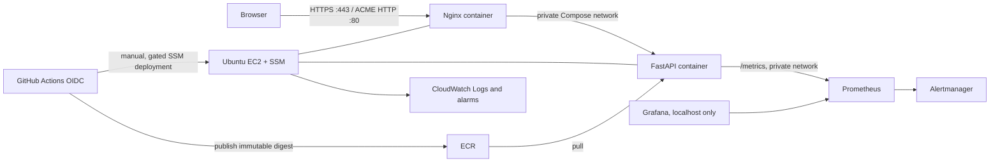

# Cloud Deployment Platform

A reusable Ubuntu application-hosting and deployment platform built around
FastAPI, Nginx, Docker Compose, Ansible, and AWS. It retains the original
Linux Web Infrastructure systemd/Bash deployment as a separate supported
option. The AWS design targets Mumbai (`ap-south-1`) and deliberately starts
with one EC2 instance instead of incurring the cost and complexity of a NAT
Gateway, load balancer, bastion, or managed Kubernetes cluster.

> **Scope and verification:** This repository contains local implementations
> and validation results, not a claim that AWS resources have been deployed.
> The existing systemd rollback test and the new container deployment tests
> use mocked system/service boundaries. Docker Engine integration is not
> available in the current WSL workspace, so image builds, Compose runtime,
> monitoring services, and load balancing still require validation on a
> Docker-enabled host. See [implementation status](#implementation-and-test-status).

## Architecture



For the detailed request, deployment, trust and recovery paths, see
[architecture](docs/architecture.md).

## Technology stack

- **Application:** Python 3.12, FastAPI, Uvicorn, Prometheus client
- **Web and containers:** Nginx, Docker, Docker Compose
- **Host configuration:** Ubuntu LTS, Ansible, systemd (legacy deployment)
- **Cloud infrastructure:** AWS Mumbai, Terraform, EC2, VPC, ECR, SSM, CloudWatch
- **Delivery:** GitHub Actions with OIDC; optional Jenkins pipeline
- **Observability:** Prometheus, Grafana, Alertmanager, Node Exporter
- **Optional platform:** Kubernetes manifests and local Nginx load-balancing example

## Deployment options

### Existing systemd deployment

The original [Ubuntu deployment script](scripts/deploy-ubuntu.sh) installs the
FastAPI service under systemd and configures host Nginx. It is intentionally
separate from the container platform:

```bash
sudo bash scripts/deploy-ubuntu.sh
```

The script retains its original best-effort filesystem/service rollback
behavior; it does not use atomic, versioned releases. Its rollback integration
test remains in
[scripts/test-full-rollback-isolated.sh](scripts/test-full-rollback-isolated.sh).

### Local Docker Compose

Requires Docker Engine with the Compose plugin:

```bash
cp .env.example .env
# Set GRAFANA_ADMIN_PASSWORD to a unique random value before enabling monitoring.
docker compose -f compose.yaml -f compose.override.yaml up --build -d
curl -fsS http://127.0.0.1:8080/api/health
```

Optional monitoring starts Prometheus, Alertmanager, Grafana and Node Exporter.
Grafana is bound to loopback only:

```bash
docker compose \
  -f compose.yaml \
  -f compose.override.yaml \
  -f compose.monitoring.yaml \
  --profile monitoring up --build -d
```

Open `http://127.0.0.1:3000` and use the credentials configured in the ignored
`.env` file. Do not use the example placeholder password.

### AWS deployment

AWS resources are **not** created by this repository automatically. Terraform
is split into a protected state-bucket bootstrap root and an independent
application-infrastructure root. After account setup and explicit operator
review, follow [AWS deployment](docs/deployment-aws.md). It covers state
migration, OIDC, Terraform review, DNS/TLS, Ansible, and protected GitHub
deployment. Never commit `.tfvars`, backend configuration, state, credentials,
or private keys.

## API

| Endpoint | Purpose |
|---|---|
| `GET /health` (proxied at `/api/health`) | Compatibility health response with service and release version |
| `GET /livez` | Liveness probe |
| `GET /readyz` | Readiness probe |
| `GET /info` (proxied at `/api/info`) | Safe environment, version, uptime, and UTC timestamp |
| `GET /metrics` | Prometheus metrics; scrape on the private network, not through public Nginx |

Interactive API documentation and OpenAPI output are disabled by default.
Nginx denies public access to metrics and OpenAPI paths. The API does not expose
instance IDs, host details, credentials, or unrestricted diagnostics.

## Repository map

```text
app/                         FastAPI app and runtime dependencies
site/                        Static portfolio site
deploy/systemd/              Existing systemd unit
deploy/nginx/                Legacy, container, TLS, and balancing configs
deploy/docker/               Non-root application image
scripts/                     Legacy/container deployment and validation helpers
tests/                       API and mocked container rollback tests
ansible/                     Ubuntu hardening, Docker, and app deployment roles
terraform/bootstrap/         Independent encrypted S3 state bucket
terraform/infrastructure/    VPC, EC2, IAM, ECR, CloudWatch, optional OIDC roles
.github/workflows/           CI, immutable image publishing, gated deployment
monitoring/                  Prometheus, Alertmanager, and Grafana provisioning
k8s/base/                    Optional Kubernetes manifests
docs/                        Architecture, deployment, security, and operations
Jenkinsfile                  Optional alternate CI pipeline
```

## Implementation and test status

| Area | Status |
|---|---|
| Original systemd/Bash deployment and isolated rollback integration test | Preserved; mocked rollback test passed |
| FastAPI endpoints, metrics, and configuration | Implemented; five API tests and Ruff passed |
| Nginx headers, private API routing, metrics/OpenAPI restrictions | Implemented; parser check attempted, host test hit a log-file permission issue |
| Docker image and Compose variants | Implemented; not built or runtime-validated (Docker Desktop WSL integration unavailable) |
| Container deploy validation and rollback | Implemented; mock test covers healthy deployment, unhealthy rollback, and mutable-tag rejection |
| Ubuntu Ansible roles | Implemented; syntax check passed with local Ansible 2.10.8; configured CI targets Ansible 2.19. Real-host connectivity requires the configured SSH key through SSM |
| Terraform state and AWS infrastructure | Implemented; format and validation passed without AWS credentials; no plan/apply |
| GitHub Actions / OIDC and Jenkins | Initial GitHub CI failed during action setup and Ansible lint; fixes under review. AWS OIDC and Jenkins remain untested |
| Prometheus, Alertmanager, Grafana | Configuration implemented; `promtool`, `amtool`, and runtime not validated locally |
| Kubernetes and Nginx replica example | Optional manifests/config implemented; not validated against a local cluster or runtime |
| AWS, DNS, ACME certificate issuance/renewal, SSM deployment | Not deployed or tested; requires explicit operator setup and authorization |

See [operations and recovery](docs/operations.md) for validation commands and
limitations. The state migration and cloud cost/security assumptions are in
[security and cost](docs/security-and-cost.md).

## Local checks

Python tests and lint:

```bash
python -m pip install -r requirements-dev.txt
python -m pytest -q
ruff check app tests
```

Shell checks, including both rollback tests:

```bash
bash -n scripts/deploy-ubuntu.sh scripts/deploy-container.sh
shellcheck scripts/deploy-ubuntu.sh scripts/deploy-container.sh
bash scripts/test-full-rollback-isolated.sh scripts/deploy-ubuntu.sh
bash tests/test_deploy_container.sh
```

Terraform (no AWS resources are provisioned by these validation commands):

```bash
terraform fmt -check -recursive terraform
for root in terraform/bootstrap terraform/infrastructure; do
  terraform -chdir="$root" init -backend=false -input=false
  terraform -chdir="$root" validate
done
```

Ansible syntax check:

```bash
cd ansible
ansible-playbook --syntax-check -i inventory.example.ini site.yml
```

Compose validation requires a reachable Docker Engine:

```bash
bash scripts/validate-compose.sh
```

## Further documentation

- [Architecture and data flows](docs/architecture.md)
- [AWS deployment and GitHub publication](docs/deployment-aws.md)
- [Operations, validation, and recovery](docs/operations.md)
- [Security assumptions and cost controls](docs/security-and-cost.md)
