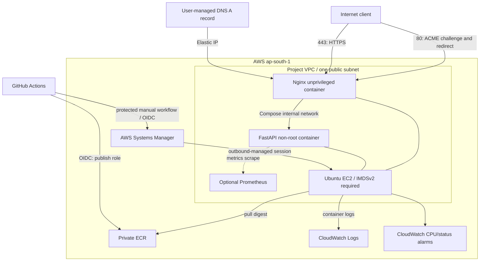

# Architecture and data flows

## Initial cloud deployment

The initial design intentionally trades high availability for low operational
and cloud cost: one Ubuntu 24.04 EC2 instance in one public subnet/AZ, with
public HTTPS at Nginx and no direct public route to FastAPI. It is not a
multi-AZ or production HA architecture.



The VPC has an Internet Gateway and default route. There is no NAT Gateway,
ALB, bastion, or managed Kubernetes control plane. EC2 has an instance role
for SSM, ECR pulls, and CloudWatch log writes. The security group permits only
configurable HTTP/HTTPS ingress and has no SSH ingress. Administration uses
SSM (Ansible may tunnel SSH through SSM when the controller has AWS CLI access).

## Request path

1. DNS resolves the configured hostname to the instance's Elastic IP.
2. Nginx handles ACME HTTP-01 challenges on port 80; other HTTP requests
   redirect to HTTPS.
3. TLS terminates in an unprivileged Nginx container. The certificate and
   private key are mounted read-only from the host.
4. Nginx proxies `/api/` to FastAPI on the private Compose network. FastAPI
   does not publish a host port.
5. Nginx serves the static portfolio from a read-only mount.
6. `/api/metrics` and `/api/openapi.json` are rejected at the public proxy.
   Prometheus can scrape FastAPI `/metrics` on the private network when the
   optional monitoring profile is enabled.

The legacy deployment is separate: host Nginx proxies to a systemd-managed
FastAPI process bound to loopback port 8000. Do not combine its Nginx config
with the container Nginx config on the same host.

## Release and rollback path

```mermaid
sequenceDiagram
    participant Dev as Developer
    participant CI as GitHub Actions
    participant ECR as Private ECR
    participant SSM as Systems Manager
    participant Host as Ubuntu host
    Dev->>CI: Push to protected main
    CI->>CI: Tests, lint, build, vulnerability scan
    CI->>ECR: Publish commit tag; capture digest
    Dev->>CI: Dispatch staging deploy with digest
    CI->>SSM: Assume short-lived OIDC role; send command
    SSM->>Host: Run deploy-container.sh
    Host->>ECR: Authenticate and pull immutable digest
    Host->>Host: Update .env; restart; health + proxy checks
    alt Validation fails and prior release exists
      Host->>ECR: Pull previous digest
      Host->>Host: Restore .env and verify rollback
    else Validation passes
      Host-->>SSM: Release healthy
    end
```

The publish role is limited to the configured repository's `main` branch.
The deployment role trust is limited to the repository's protected GitHub
`staging` Environment. Deployment input is a SHA-256 digest, not a mutable
tag. The helper keeps a temporary copy of the previous environment and
restores the recorded image/version if checks fail. A first deployment has no
previous release to restore. The helper's rollback is tested with fake Docker
commands; a real container-runtime failure/recovery test remains outstanding.

## Optional/advanced components

- `compose.monitoring.yaml`: private Prometheus, Alertmanager, and Node
  Exporter networks; Grafana is only published to `127.0.0.1`.
- `compose.load-balancing.yaml`: Nginx upstream example; scale the API service
  separately and verify DNS/service discovery on the selected Docker Engine.
- `k8s/base/`: two-replica API Deployment, ClusterIP Service, ConfigMap,
  resource limits, non-root security context, and probes. It is not part of
  the one-VM deployment and is not a managed cluster installation.
- `Jenkinsfile`: alternate CI example. It is not coupled to GitHub Actions.

Alertmanager currently uses a discard receiver; it evaluates and routes alerts
but does not notify a human until an operator configures a receiver and
credentials.
